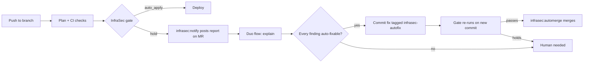

# InfraSec

**AI explains and fixes. A deterministic gate decides.**

InfraSec reviews Terraform changes before they ship. A plain-Python scorer rates every change and returns `auto_apply` or `hold`. When a change is held, GitLab Duo agents explain why in plain language, commit a safe fix to the branch, and a CI job merges it only after the gate re-run passes. Anything the agent cannot fix safely goes to a human.

The principle: **let AI explain and fix, but never let it invent the risk number.** Decisions are reproducible and auditable because the score never comes from a model.

## How it works



1. **Gate (deterministic).** `scripts/infrasec_decide.py` scores the Terraform plan and also records whether conventional CI (`terraform fmt/validate`, tests) passed. The report includes a "Value added" line saying whether CI alone would have shipped the change.
2. **Notify.** If the gate holds a branch that has an open merge request, `scripts/infrasec_notify.py` posts the report on the MR and mentions the Duo flow. The comment carries the context the agent needs: project, MR number, source branch and target branch.
3. **Explain and fix (agent).** The flow in `flows/infrasec-autofix.yaml` always posts an explanation: what was blocked, each finding code with its exact resource address, and the fix hint. It then fixes only if every finding is one of `NETWORK_OPEN_TO_WORLD`, `S3_PUBLIC_ACCESS_LOOSENED`, `DB_PUBLICLY_ACCESSIBLE`, `ENCRYPTION_DISABLED` or `OIDC_TRUST_WIDENED`, and the auto-fix budget is not used up. It reads the file on the target branch and restores the exact previous value instead of guessing. It commits with a message ending in `[infrasec-autofix]`.
4. **Merge (CI, not the agent).** GitLab does not allow the `/merge` quick action in AI workflows, so `scripts/infrasec_automerge.py` does it after the gate passes.

### Guardrails

- The agent never overrules, re-scores or softens the gate, and never approves anything.
- It never edits IAM permissions, `scripts/`, `agent/`, `tests/`, `.gitlab-ci.yml` or `.infrasec/`.
- Auto-merge happens only when all of these hold: every earlier job succeeded, the pipeline's commit is the MR's current head, that commit is tagged `[infrasec-autofix]`, and the MR is not a draft and has no conflicts. The merge request pins the head SHA, so a later push cancels it.
- Findings the agent cannot fix (IAM, new resource types, cost, parse errors) stop for a human, with a note explaining why.
- Repeated auto-fix attempts are capped: the gate counts recent `[infrasec-autofix]` commits.

## Decision rules

The plain Python evaluator is authoritative and fail-closed:

| Signal                                              | Decision               |
|-----------------------------------------------------|------------------------|
| OIDC trust policy widened                           | Hold, highest priority |
| IAM or policy resource touched                      | Hold                   |
| New resource type in this repo's history            | Hold                   |
| Cost change is at least $2/month or 40% of baseline | Hold                   |
| Parse error or unknown action                       | Hold                   |
| No escalation rule triggered                        | Auto-apply             |

Fastino's open-weight GLiNER2.5-Decide checkpoint is available as an optional pipeline-side advisory classifier. Its output is attached to the API response but does not change the deterministic action. This keeps the model useful for review context without giving a text classifier authority over infrastructure security policy. See the [model documentation](https://github.com/fastino-ai/GLiNER2#-available-models).

## Try the demo on GitLab

The demo target is `demo-target/main.tf`, which defines `aws_security_group.app`.

1. Create a branch from `main` that changes the SSH ingress `cidr_blocks` to `0.0.0.0/0`, push it and open a merge request.
2. The pipeline runs. `infrasec:decide` fails and the MR is held.
3. `infrasec:notify` comments on the MR and mentions the flow. The agent replies with the explanation and commits the original CIDR back, tagged `[infrasec-autofix]`.
4. The pipeline re-runs on the new commit, the gate passes, and `infrasec:automerge` merges.

No AWS credentials are needed. Without `AWS_ACCESS_KEY_ID` the deploy jobs print `DEMO MODE` and apply nothing.

### GitLab setup

| What | Where |
|------|-------|
| `flows/infrasec-autofix.yaml` | Paste into Automate > Flows > your flow > Edit |
| `INFRASEC_TOKEN` | CI/CD variable: project access token, `api` scope, Developer role (must be allowed to merge into `main`) |
| `INFRASEC_FLOW_HANDLE` | CI/CD variable: the `@handle` GitLab autocompletes for the flow |
| `DEMO_PLAN` (optional) | Path to a saved plan under `demo/plans/` to skip `terraform plan` |

## Use in a GitHub repository

Copy [`examples/infra-risk.yml`](examples/infra-risk.yml) to `.github/workflows/infra-risk.yml`, set repository variables `INFRA_RISK_CLIENT_ROLE_ARN` and `INFRA_RISK_API_URL`, then replace the sample Git URL with this repository's canonical URL. The action assumes the scoped AWS role through GitHub OIDC, creates a Terraform plan and submits it to the decision API.

To use GLiNER locally in the CI runner:

```bash
pip install 'infra-risk[gliner] @ git+https://github.com/YOUR_ORG/infra-risk.git'
export INFRA_RISK_GLINER_MODEL=fastino/GLiNER2.5-Decide
infra-risk --plan plan.json
```

The default package is smaller: `pip install 'infra-risk[aws] ...'` installs only the AWS signing client. The GLiNER extra downloads PyTorch dependencies and the model weights on the runner.

## Decision API

`POST` a JSON object containing `repo`, `head_sha` and `plan_json` to the Lambda Function URL. Requests are signed with AWS SigV4 and the endpoint requires AWS IAM authorization.

The Python CLI exits `0` for `auto_apply`, `2` for `hold`, and nonzero on request or credential errors. CI should treat all nonzero exits as blocked.

## Repository map

- `agent/plan_parser.py`, `agent/oidc_diff.py`, `agent/cost_estimate.py`, `agent/decision_engine.py`: deterministic plan analysis.
- `agent/handler.py`: synchronous Function URL API and Lambda entry point.
- `infra_risk/`: small installable pipeline client (`infra-risk` command).
- `flows/infrasec-autofix.yaml`: the GitLab Duo flow that explains and fixes held changes.
- `scripts/infrasec_decide.py`, `scripts/infrasec_notify.py`, `scripts/infrasec_automerge.py`: the gate, the MR notification and the guarded merge.
- `.gitlab-ci.yml`: pipeline wiring for the loop above.
- `demo-target/`: the Terraform the demo changes. `demo/plans/`: saved plans.
- `terraform/`: Lambda, IAM OIDC access, decision history and notifications.
- `docs/workflow.md`: API and pipeline integration details.
- `tests/`: parser, OIDC diff, decision matrix, notify and auto-merge coverage.

```bash
pip install -r requirements.txt pytest
python -m pytest tests -q
```

## Deploy the decision API

Terraform requires AWS credentials and Terraform 1.5+. Build and push the container image to the ECR URL from Terraform output, then set `infra_risk_image_uri` and apply the stack. The Function URL and scoped GitHub OIDC client role are exposed as the `decision_api_url` and `plan_submitter_role_arn` outputs. Review the IAM trust inputs (`github_org`, `github_repo`, `allowed_ref`) before deployment.

## License

MIT. See [LICENSE](LICENSE).