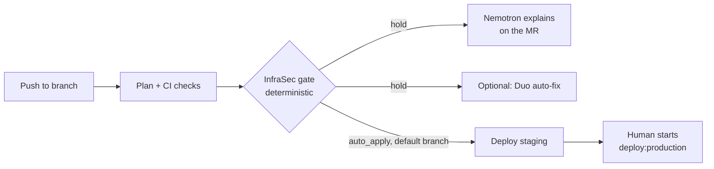

# InfraSec

> **License:** MIT, see [LICENSE](LICENSE). **Stack:** deterministic Python gate, GitLab CI, AWS Lambda decision API, NVIDIA Nemotron on Nebius Token Factory.

**AI does the work. Deterministic code decides. A human approves what reaches production.**

InfraSec reviews Terraform changes before they ship. A plain-Python evaluator reads the Terraform plan and returns `auto_apply` or `hold`. When a change is held, an NVIDIA Nemotron model served on Nebius Token Factory explains it on the merge request in plain language: what changed, why it was held, and how to roll it back. The model never produces the verdict, and production deploys are a manual job.

## What it does

1. **Gate (deterministic).** `scripts/infrasec_decide.py` scores `terraform show -json` output with no AWS account and no network. It also records whether conventional CI (`terraform fmt`/`validate`, tests) passed, and the report says whether CI alone would have shipped the change.
2. **Explain (Nemotron on Token Factory).** If the gate holds a branch, `infrasec:explain` runs `scripts/infrasec_explain.py`. It sends the decision JSON and the Terraform diff to Nemotron and posts a three-part note (what changed, why it was held, rollback plan) on the open merge request.
3. **Notify and fix (optional, GitLab Duo).** `infrasec:notify` posts the report and mentions a GitLab Duo flow (`flows/infrasec-autofix.yaml`) that can commit a narrow fix. This needs GitLab Duo Agent Platform and is not required for the Nemotron step. See [Optional: GitLab Duo auto-fix](#optional-gitlab-duo-auto-fix).
4. **Human approval.** `deploy:staging` runs after the gate passes on the default branch. `deploy:production` is a **manual** job and waits for a person to start it.



The principle: **never let a model invent the risk number.** Decisions are reproducible and auditable because the score never comes from a model.

## How this project uses NVIDIA Nemotron and Nebius Token Factory

`scripts/infrasec_explain.py` calls Nebius Token Factory through its OpenAI-compatible API (`https://api.tokenfactory.nebius.com/v1`) with a Nemotron model chosen by `NEBIUS_MODEL_ID`. It uses only the Python standard library, so there is no SDK to install.

- **Advisory only.** The system prompt forbids re-scoring or questioning the verdict, which comes from the evaluator. The script exits `0` in every case: with no key set, no model set, or Token Factory unreachable it prints a message and the pipeline carries on unchanged.
- **Grounded input.** The prompt contains only the decision JSON and the `.tf` diff (both truncated to a fixed size), and asks for exactly three short sections.
- **Reasoning output stripped.** Any `<think>...</think>` block is removed before the note is posted.
- **Output.** The note is printed in the job log and posted on the merge request, headed "Explanation by NVIDIA Nemotron on Nebius Token Factory (advisory only)".

Environment variables:

| Variable | Purpose |
|---|---|
| `NEBIUS_API_KEY` | Token Factory API key (masked CI/CD variable) |
| `NEBIUS_MODEL_ID` | Nemotron model id from the Token Factory catalog |
| `NEBIUS_BASE_URL` | Optional, defaults to `https://api.tokenfactory.nebius.com/v1` |
| `INFRASEC_TOKEN` | Project access token (`api` scope) used to post the MR note |

Pick a model id:

```bash
NEBIUS_API_KEY=... python scripts/infrasec_explain.py --list-models
```

## Try the demo

The demo target is `demo-target/main.tf`, which defines `aws_security_group.app` with SSH open to `10.0.0.0/8`. The provider is configured to plan offline, so **no AWS credentials are needed**.

**Locally, with a saved plan:**

```bash
pip install -r requirements.txt pytest
python scripts/infrasec_decide.py --plan demo/plans/ssh_open.json --ci-status pass
# exit code 2 = held; writes infrasec-decision.json and infrasec-report.md
NEBIUS_API_KEY=... NEBIUS_MODEL_ID=... python scripts/infrasec_explain.py --decision infrasec-decision.json
```

Saved plans: `demo/plans/ssh_open.json` (held), `demo/plans/s3_public.json` (held), `demo/plans/safe.json` (passes).

**On GitLab:**

1. Add CI/CD variables `NEBIUS_API_KEY` (masked), `NEBIUS_MODEL_ID` and `INFRASEC_TOKEN` (project access token, `api` scope, Developer role).
2. Create a branch from `main`, change the SSH `cidr_blocks` in `demo-target/main.tf` to `["0.0.0.0/0"]`, push it and open a merge request.
3. `infrasec:decide` fails and holds the change. `infrasec:explain` posts the Nemotron note on the merge request.
4. Without `AWS_ACCESS_KEY_ID`, the deploy jobs print `DEMO MODE` and apply nothing.

## Decision rules

The plain Python evaluator is authoritative and fail-closed:

| Signal                                              | Decision               |
|-----------------------------------------------------|------------------------|
| OIDC trust policy widened                           | Hold, highest priority |
| IAM or policy resource touched                      | Hold                   |
| New resource type in this repo's history            | Hold                   |
| Cost change is at least $2/month or 40% of baseline | Hold                   |
| Parse error or unknown action                       | Hold                   |
| No escalation rule triggered                        | Auto-apply             |

Findings also carry codes such as `NETWORK_OPEN_TO_WORLD`, `S3_PUBLIC_ACCESS_LOOSENED`, `DB_PUBLICLY_ACCESSIBLE`, `ENCRYPTION_DISABLED` and `OIDC_TRUST_WIDENED`.

Fastino's open-weight GLiNER2.5-Decide checkpoint is available as an optional advisory classifier. Its output is attached to the API response but never changes the deterministic action. See the [model documentation](https://github.com/fastino-ai/GLiNER2#-available-models).

## Optional: GitLab Duo auto-fix

Built for the GitLab AI Hackathon and kept here as an optional extra. It needs GitLab Duo Agent Platform and two CI/CD variables.

- `flows/infrasec-autofix.yaml` (paste into Automate > Flows) explains a held change and, only when every finding is auto-fixable and the attempt budget is not used up, commits the previous value back, tagged `[infrasec-autofix]`.
- `scripts/infrasec_automerge.py` merges that fix after the gate re-run passes. It only merges a head commit tagged `[infrasec-autofix]`, and only when the merge request is not a draft and has no conflicts.
- Guardrails: the agent never edits IAM permissions, `scripts/`, `agent/`, `tests/`, `.gitlab-ci.yml` or `.infrasec/`, and attempts are capped.
- Variables: `INFRASEC_TOKEN` and `INFRASEC_FLOW_HANDLE` (the `@handle` GitLab autocompletes for the flow).

Auto-merge into the default branch is automatic for these tagged fixes. Reaching production still requires a person to start `deploy:production`.

## Decision API (AWS)

The same evaluator is deployed as an IAM-authenticated AWS Lambda Function URL. `POST` a JSON object containing `repo`, `head_sha` and `plan_json`; requests are signed with AWS SigV4. The `infra-risk` CLI exits `0` for `auto_apply`, `2` for `hold`, and nonzero on request or credential errors. CI should treat all nonzero exits as blocked. The endpoint is not publicly callable, so the demo above uses the offline gate instead.

To use it from another repository, copy [`examples/infra-risk.yml`](examples/infra-risk.yml) to `.github/workflows/infra-risk.yml` and set repository variables `INFRA_RISK_CLIENT_ROLE_ARN` and `INFRA_RISK_API_URL`. To add the optional GLiNER classifier on the runner:

```bash
pip install 'infra-risk[gliner] @ git+https://github.com/spacey-cadet/infra-sec.git'
export INFRA_RISK_GLINER_MODEL=fastino/GLiNER2.5-Decide
infra-risk --plan plan.json
```

The default package is smaller: `pip install 'infra-risk[aws] ...'` installs only the AWS signing client.

Deploying the API needs AWS credentials and Terraform 1.5+. Build and push the container image to the ECR URL from Terraform output, set `infra_risk_image_uri` and apply `terraform/`. Review the IAM trust inputs (`github_org`, `github_repo`, `allowed_ref`) before deployment.

## Repository map

- `agent/`: deterministic plan analysis (`plan_parser.py`, `oidc_diff.py`, `cost_estimate.py`, `decision_engine.py`) and the Lambda entry point `handler.py`.
- `scripts/infrasec_decide.py`: the offline gate. `scripts/infrasec_explain.py`: the Nemotron explanation. `scripts/infrasec_notify.py` and `scripts/infrasec_automerge.py`: the optional Duo loop.
- `infra_risk/`: installable pipeline client (`infra-risk` command).
- `.gitlab-ci.yml`: pipeline wiring. `flows/`: GitLab Duo flows.
- `demo-target/`: the Terraform the demo changes. `demo/plans/`: saved plans.
- `terraform/`: Lambda, IAM OIDC access, decision history and notifications.
- `docs/`: `workflow.md` (API and pipeline details), `decision_engine.md`, `NEBIUS_SUBMISSION.md`.
- `tests/`: parser, OIDC diff, decision matrix, notify, auto-merge and explain coverage. The explain tests use a local fake server, so no key is needed.

```bash
pip install -r requirements.txt pytest
python -m pytest tests -q
```

## Hackathon history

- **GitLab AI Hackathon (submitted, frozen):** the deterministic gate, the Duo explain-and-fix loop, the suggester and the AWS decision API. Autonomy level: Supervised.
- **Nebius x NVIDIA Global AI Hackathon (this repository):** new in this period are the Nemotron explanation on Nebius Token Factory (`scripts/infrasec_explain.py`, its tests and the `infrasec:explain` job), a manual `deploy:production` gate, and this README. The evaluator itself is unchanged by design.

## License

MIT. See [LICENSE](LICENSE).